# VanaLog

Never miss what matters in Vana'diel. VanaLog is an Ashita v4 addon that
automatically tracks **RSE**
windows, **airship and ferry** departures, **crafting guild** shop hours, the
day/moon calendar, and your own custom timers and notes -- then fires custom
**alerts** to keep you notified of exactly the events you care about, down to
daily Guild Point and Fishing goal reminders. A built-in **Journal** keeps a
dated log of what you've worked on along the way.

On top of that, VanaLog is a clean, fully customizable overlay -- scalable,
with your choice of colors, opacity, text, and theme presets, so it fits
right into your UI instead of looking bolted on.

World Info is computed entirely locally, from the real-world clock. It does
**not** contact phoenix-xi.com, any wiki, or any other server at runtime --
see [Credits](#credits) below.

## Screenshots

**Settings window**

<table>
<tr>
<td>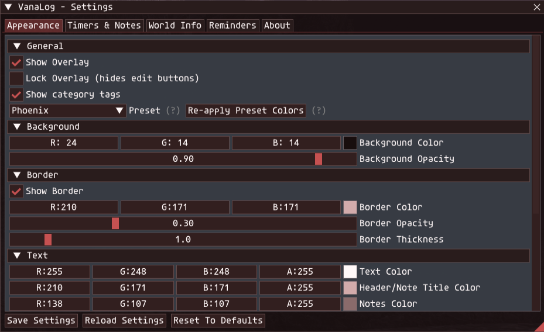<br><sub>Appearance -- theme presets, colors, Low Profile Mode, Window Scale</sub></td>
<td>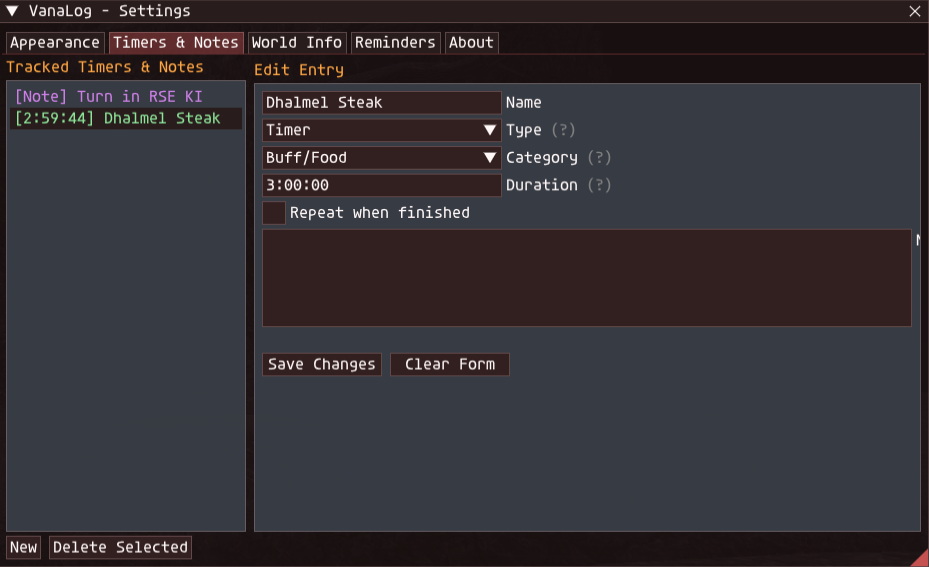<br><sub>Timers & Notes -- add/edit entries, category colors</sub></td>
</tr>
<tr>
<td>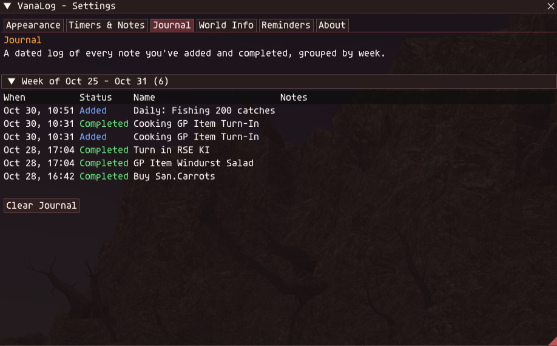<br><sub>Journal -- dated log of notes added/completed, by week</sub></td>
<td>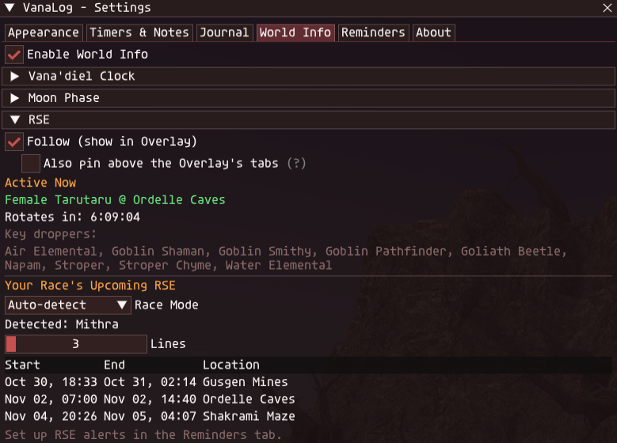<br><sub>World Info -- RSE, day/moon calendar</sub></td>
</tr>
<tr>
<td>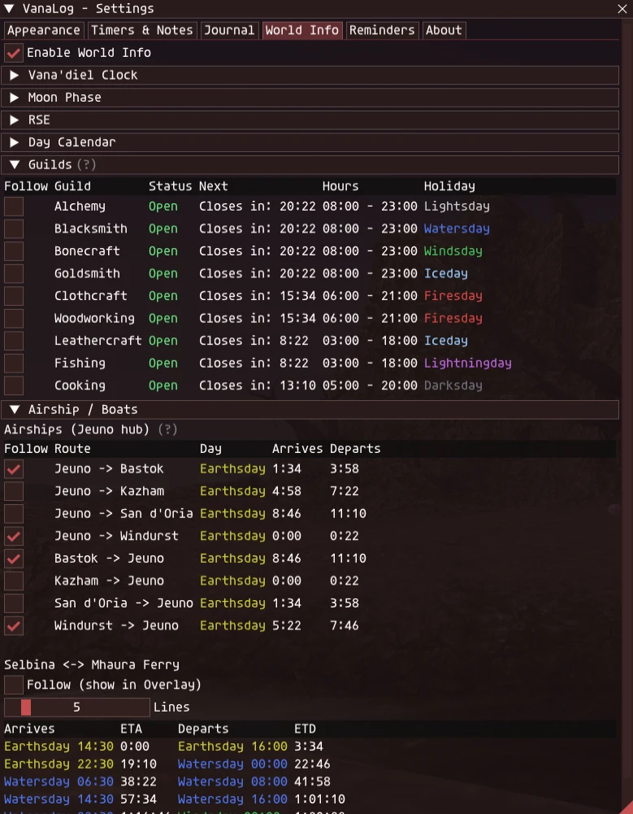<br><sub>World Info -- crafting guild hours, airship/ferry schedules (individually followable)</sub></td>
<td>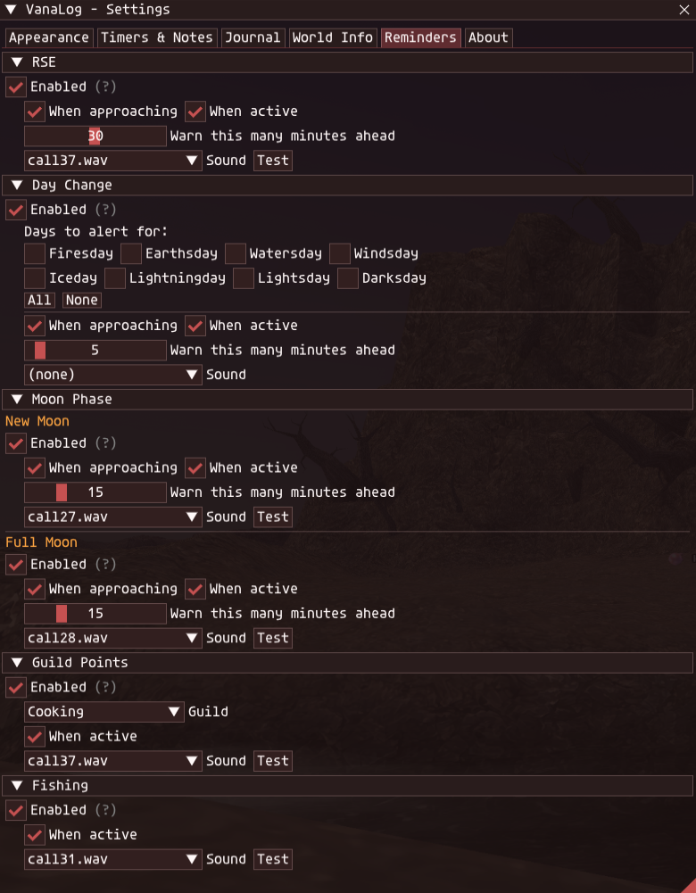<br><sub>Reminders -- RSE, Day Change, Moon Phase, Guild Points, Fishing</sub></td>
</tr>
<tr>
<td>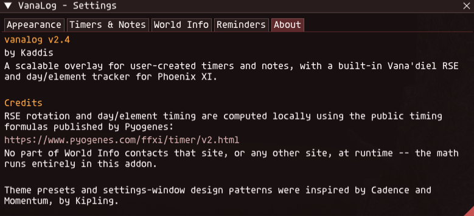<br><sub>About -- credits</sub></td>
<td></td>
</tr>
</table>

**Overlay**

<table>
<tr>
<td>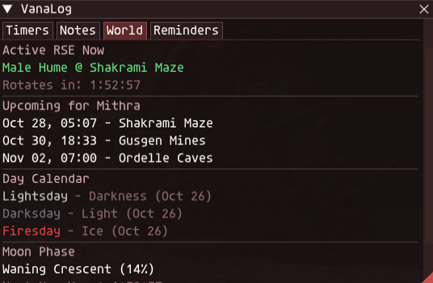<br><sub>World -- only what you've chosen to Follow</sub></td>
<td>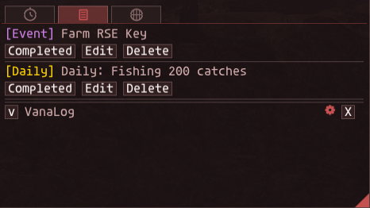<br><sub>Notes</sub></td>
</tr>
<tr>
<td>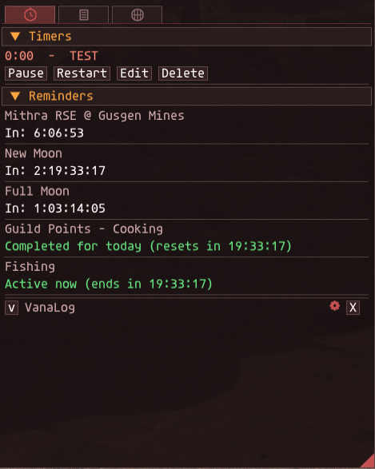<br><sub>Timers & Reminders</sub></td>
<td>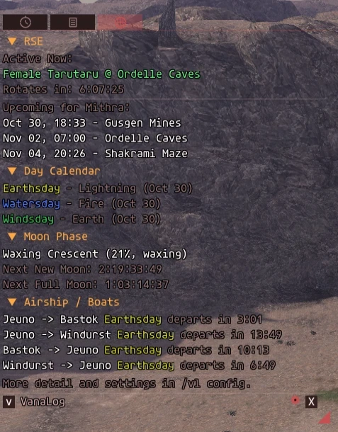<br><sub>Low Profile Mode -- no background/border, just text and icons</sub></td>
</tr>
</table>

## Installation

1. Copy the `vanalog` folder into your Ashita `addons` folder, so you end
   up with `Ashita\addons\vanalog\vanalog.lua`.
2. In-game (or in your Ashita `scripts\default.txt` autoload list), run:
   ```
   /addon load vanalog
   ```
3. Run `/vl config` to open the settings window and add your first timer or
   note, or check the World Info tab.

Settings are saved per-character automatically under:
`Ashita\config\addons\vanalog\<CharacterName>_<ServerId>\settings.lua`

## Commands

| Command | What it does |
|---|---|
| `/vl` | Toggles the timers/notes overlay on and off. |
| `/vl config` | Opens/closes the settings & editor window. |
| `/vl add <name> <duration> [notes...]` | Quick-adds a countdown timer. Duration accepts `hh:mm:ss`, `mm:ss`, or plain seconds (e.g. `/vl add "Sky God" 45:00 kill the placeholder`). |
| `/vl note <name> [notes...]` | Quick-adds a pinned note with no countdown. |
| `/vl del <name>` | Removes the timer/note with the given name. |
| `/vl clear` | Removes all timers and notes. |
| `/vl lock` | Toggles locking the overlay in place (hides the edit buttons and freezes position/size for a clean HUD look). |
| `/vl world` | Prints the currently active RSE pop and your race's next upcoming RSE pop to chat. |
| `/vl reload` | Reloads settings from disk, discarding unsaved changes. |
| `/vl reset` | Resets all settings back to their defaults. |
| `/vl help` | Prints this command list to the chat log in-game. |

`/vanalog` works as a longhand alias everywhere `/vl` does.

You can also right-click the overlay itself for a quick menu (add entry,
lock/unlock, open settings, clear all).

## Using the overlay

- **Timers** count down from a set duration. They can optionally repeat,
  auto-restarting as soon as they hit zero -- handy for recasts or pop timers.
- **Notes** are just a pinned name + note text with no countdown, for things
  you want to remember (strategy reminders, macros, etc.) -- optionally with
  their own one-shot **"Remind me"** alert (see below). A note can also be
  marked **Completed**, which logs it to the Journal (settings -> Journal
  tab) and removes it from the active list.
- Each entry has a **category** (General, Recast, Pop/Spawn, Buff/Food, Craft,
  Event, Mission, Quest, Daily) that tags its name in the overlay, purely for
  organization. Each category's color is customizable (Timers & Notes tab ->
  Category Colors) and is used for both its tag and its list color. Daily is
  used automatically by the Guild Points and Fishing reminders' auto-created
  Notes (see Reminders below).
- In the overlay, an entry's category tag is shown *before* its content, e.g.
  `[Pop/Spawn] 45:00  -  Valkurm Emperor`.
- Each entry can have multi-line notes attached, shown wrapped underneath it
  in the overlay.
- A note with "Remind me" enabled shows a live countdown ("Reminder in: ...")
  underneath it, and prints a chat line (plus an optional sound) once it
  elapses -- a one-shot alert, independent of a Timer's own countdown.
- Entries can be manually reordered by clicking and dragging them in the
  settings window's entry list -- the overlay picks up the new order
  automatically, since both read the same list.
- While unlocked, each entry shows **Pause/Resume**, **Restart**, **Edit**,
  and **Delete** buttons. Lock the overlay (`/vl lock` or the right-click
  menu) to hide these and get a clean display.
- The overlay window itself is a normal draggable/resizable window when
  unlocked -- drag the title bar to move it, drag a corner/edge to resize it.
- The overlay has three icon tabs, hand-drawn rather than text (hover one for
  its name) -- a clock/stopwatch for **Reminders** (your Timers on top, and a
  live countdown for whichever world Reminders you've turned on,
  underneath), a notepad for **Notes**, and a globe for **World** -- so you
  can flip between them without opening the full settings window. World is
  hidden if World Info is disabled. Each icon's color tracks your chosen
  theme preset. Drag a tab to reorder it. The tab icons stay fixed in place
  if a tab's content grows long enough to scroll -- only that tab's own list
  scrolls, not the tab bar itself.
- The overlay's **World** tab only shows whatever you've chosen to **Follow**
  (World Info tab in settings -> each section's own Follow checkbox, or
  per-entry for Guilds/Airships) -- nothing is followed by default, so the
  tab starts out empty with a pointer to where to turn things on. Each
  followed section is its own collapsible, color-coded header.
- Optionally pin the **active RSE** as a line above the tabs regardless of
  which tab is open (World Info tab in settings -> RSE section -> Follow it,
  then "Also pin above the Overlay's tabs"). This only appears once RSE is
  followed, so it can't show up on its own without RSE also being in the
  World tab.
- Optionally play a sound and/or flash when a timer finishes (Appearance tab).
- The overlay fully follows your chosen theme preset -- not just its
  background/border/text, but button, tab, and header colors too.
- A small cogwheel button sits in the top-right corner of the overlay at all
  times (click to open the settings window) -- useful since locking the
  overlay hides its title bar entirely. It's colored from your active theme
  preset's accent, so it always matches whatever look you've picked.
- The overlay can be collapsed to just its title bar, the same as the
  settings window -- click the arrow next to the title.
- **Move title bar to bottom** (Appearance -> General) leaves the entire top
  of the overlay clean/transparent above the tabs, moving the collapse
  arrow, "VanaLog" label, settings gear, and close button into a custom bar
  at the bottom instead -- full functionality, just relocated.
- The bottom-right resize handle on both the overlay and settings window is
  colored with your theme's accent (and lights up on hover/drag), instead of
  ImGui's barely-visible default gray.

## World Info (`/vl config` -> World Info tab)

A pure display tab -- every section below is always shown here in full,
each its own collapsible header so you can fold away what you don't care
about right now. Alert/reminder setup lives in the separate **Reminders**
tab, not here.

Each section (and, for Guilds and Airship/Boats, each individual entry) has
its own **Follow** checkbox. Nothing is followed by default -- the
*overlay's* World tab only ever shows what you've explicitly followed, so
you're never forced to track something you don't care about; this settings
tab itself is unaffected and always shows everything.

- **Vana'diel Clock** -- current date/time and elemental day of the week.
- **Moon Phase** -- current phase, percent, and whether it's waxing or
  waning, plus a countdown to the next New Moon and next Full Moon (or
  "active, ends in..." if one is in progress) -- the two phases that
  actually matter in-game, since fish bite rates drop to ~7s (from the
  default ~15s) during either one, and gardening crop quality is affected
  too.
- **RSE** -- which race's camp is currently spawning, where, how long until
  the rotation moves on, the key-item droppers for that camp (wrapped to fit
  the window instead of running off the edge), and a forward schedule of
  start/end times and locations for a chosen race. Race is auto-detected from
  your logged-in character by default, with a manual override if you'd rather
  track a different race (e.g. an alt, or a friend's).
- **Day Calendar** -- a forward-looking list of upcoming Vana'diel days, each
  elemental day and moon phase, so you can plan accordingly.
- **Guilds** -- every crafting guild's open/closed/holiday status, hours, and
  a live countdown to its next opening or closing, in one table. Hover a
  guild's name for its shop NPC's zone and coordinates.
- **Airship / Boats** -- next-departure times for all 8 Jeuno airship routes,
  plus an upcoming-departures table for the Selbina<->Mhaura ferry.
- Lists default to 8 lines (5 for the ferry) and can be expanded (sliders,
  3-40 / 3-20).

## Reminders (`/vl config` -> Reminders tab)

Five collapsible sections -- **RSE**, **Day Change**, **Moon Phase** (which
itself holds independently-configurable New Moon and Full Moon
sub-sections), **Guild Points**, and **Fishing**. Each reminder has the same
core controls:

- **Enabled** -- turns that category's reminders on.
- **When approaching** / **When active** -- alert as the window is coming up,
  when it starts, or both.
- **Warn this many minutes ahead** -- how early an "approaching" alert fires
  (1-60 minutes).
- **Sound** -- optional, per reminder. "(none)" or any sound file, picked
  from a combined list of 22 bundled in-game "call" sound effects (converted
  from the game's own `se000017.spw`-`se000038.spw`, since those are a
  proprietary format Windows can't play directly) plus anything you drop into
  `Ashita\config\addons\vanalog\sounds\` yourself. A **Test** button plays
  whichever is selected. Playback is always local only -- a reminder never
  sends a chat message to your party or anyone else, regardless of what sound
  you pick.

Day Change reminders additionally let you pick **which Vana'diel days** to
alert for (all 8 by default, with "All"/"None" shortcuts) -- useful if you
only care about one or two specific days rather than every day change.

Guild Points reminders additionally let you pick **which guild** to track --
the daily Guild Point item turn-in reset happens at a fixed real-world time
(8am PT / 11am ET / 12am JPT; a single fixed UTC instant, so the US clock
times shift with daylight saving while Japan's doesn't), independent of the
Vana'diel clock entirely. Enabling it also auto-creates a Note each day --
"**{Guild} GP Item Turn-In**" -- right when that day's reset happens; marking
that Note **Completed** (overlay's Notes tab) flips this reminder's status
from "Active now" to "Completed for today" until the next day's reset
creates a fresh one. Unlike the other reminders, there's no "approaching"
option here -- the turn-in window spans from one reset to the next rather
than counting down to a fixed future start, which is what lets a completed
Note's status keep showing for the rest of the day.

Fishing reminders work exactly the same way, for the daily 200-catch goal --
same real-world reset, same auto-created Note ("**Daily: Fishing 200
catches**"), same Completed hand-off, no "approaching" option. Both Guild
Points' and Fishing's auto-created Notes are tagged with the **Daily**
category.

Each reminder prints one chat line as it fires (not spammed every frame for
however long the window stays open), and the overlay's **Reminders** tab
(same tab as Timers) shows a live countdown for everything you've turned on.

RSE reminders track your own race's next pop (same race setting as the World
Info tab).

## Journal (`/vl config` -> Journal tab)

A dated, append-only log of Notes: every note you add gets an "Added" entry,
and marking a note **Completed** (in the overlay's Notes tab) logs a
"Completed" entry and removes it from the active list -- a running receipt
of what you've worked on, independent of what's still open. Entries are
grouped into collapsible weekly buckets, newest week first and expanded by
default, older weeks collapsed, so a long-running log doesn't turn into a
wall of rows. "Clear Journal" wipes the log without touching your active
timers/notes.

## Appearance settings (`/vl config` -> Appearance tab, first tab in the window)

Each section below (General, Background, Border, Text, Alerts) is its own
collapsible header. The tab you're currently on, in any tab bar in the
addon, is marked with an accent-colored underline so it's easy to tell at a
glance -- without a solid block of color that could clash with some presets.

- **Show Overlay / Lock Overlay** -- visibility and lock toggles (same as the
  `/vl` and `/vl lock` commands).
- **Low Profile Mode** -- overlay only. Forces background, border, and
  header-background opacity to 0 for a fully see-through HUD (just text and
  icons), without touching the Background/Border opacity sliders further
  down -- turning it back off restores exactly what they were set to.
- **Window Scale** -- resizes both the overlay and this settings window to a
  percentage (50-200%) of their default size, in one click -- an alternative
  to dragging their bottom-right resize grip, which still works too (and
  isn't locked to this slider's value afterward).
- **Theme Preset** -- Phoenix (default, matches phoenix-xi.com's own
  branding), Classic FFXI, Minimal, High Contrast, Ember, Mint, Lavender, and
  a colorblind-safe preset. Picking one from the dropdown immediately reskins
  both the overlay and this window and seeds the individual colors below with
  that preset; you can still fine-tune any of them afterward, and "Re-apply
  Preset Colors" snaps them all back to the preset if you want a clean reset.
- **Background** -- background color and opacity/transparency.
- **Border** -- show/hide, color, opacity, and thickness (independent of the
  background). **Separator Thickness** (overlay only) controls the line
  drawn between entries -- 1.0 matches the thin default; anything above that
  draws a thicker hand-drawn line instead, since ImGui's own separator line
  has no built-in way to go thicker. Uses the Border color/opacity above.
- **Text** -- text color, header/note-title color, notes color, warning
  color, and finished color (used for countdown states), plus a text size
  slider. **Black Text Outline in Low Profile Mode** (overlay only) draws a
  black outline around overlay text -- simulated the same way, since there's
  no real font-level outline available (loading a bundled font crashed an
  earlier build) -- but only actually draws while Low Profile Mode is also
  on, where it keeps text readable with no background box behind it.
- **Alerts** -- the "Warn Threshold" slider controls how many seconds remain
  before a countdown switches to the warning color; you can also enable a
  finish flash and/or a sound alert (drop `.wav`/`.mp3` files into
  `Ashita\config\addons\vanalog\sounds\`).

Use **Save Settings**, **Reload Settings**, or **Reset To Defaults** at the
bottom of the Appearance tab to manage your configuration.

## Notes for testers

- This addon has no dependencies beyond what ships with Ashita v4.
- There is no custom font-family picker ("Text Type") -- an earlier build
  tried loading extra `.ttf` files into ImGui at runtime and this caused a
  crash (`EXCEPTION_ACCESS_VIOLATION` in the Present event) on at least one
  system. Text size is still fully adjustable via the "Text Size" slider,
  just not the font family.
- v2.0 fixed a crash that could happen when deleting a timer/note from the
  overlay: the delete button used to remove the entry from the list while
  that same list was still being iterated over for rendering, which could
  walk past the (now shorter) list and crash. Deletes are now deferred until
  after the render pass completes.
- If something looks wrong after an update, try `/vl reset` to rule out a
  stale settings file, or delete the character-specific settings file listed
  above and let it regenerate.
- Feedback/bug reports: describe what you did, what you expected, and what
  happened instead (a screenshot of the overlay/settings window helps a lot).

## Credits

Created by Kaddis.

RSE rotation, moon phase, the Vana'diel day/element calendar, guild hours,
and the airship/ferry schedules are all computed using the public timing
formulas published by **Pyogenes** at
<https://www.pyogenes.com/ffxi/timer/v2.html> (`timer4.js`), ported to Lua in
`core/vanadiel.lua`. That script's own license terms ask only that credit be
given and a link be placed on any page the code is used in -- this section,
and the addon's in-game About tab, are that credit and link. No network
request is made to that site (or anywhere else) by this addon; the formulas
run entirely offline against the local clock.

Guild shop NPC zone/coordinates (shown on hover in the Guilds section) are
cross-referenced from [FFXIclopedia's Guild Merchant
page](https://ffxiclopedia.fandom.com/wiki/Guild_Merchant) -- that page's own
listed hours and holidays are outdated for this server and were not used,
only the zone/coordinate data.

Theme presets and settings-window design patterns were inspired by two other
Ashita addons for this server, **Cadence** and **Momentum**, both by
**Kipling**. No code was copied from either; VanaLog's theme and UI code is
its own, written in the same spirit.

The 22 bundled "call" sound options (`sounds/call17.wav`-`call38.wav`) are
the game's own `se000017.spw`-`se000038.spw` sound effects, converted to
`.wav` with [vgmstream](https://github.com/vgmstream/vgmstream), an
open-source game-audio tool, since the game's own `.spw` container isn't
something Windows can play directly. Nothing about this reads or writes your
actual game files at runtime; the conversion was a one-time, offline step.
